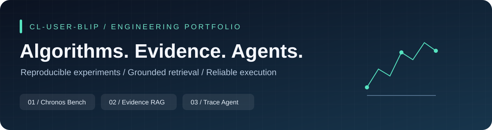

## Hi there 👋

<!--
**cl-user-blip/cl-user-blip** is a ✨ _special_ ✨ repository because its `README.md` (this file) appears on your GitHub profile.

Here are some ideas to get you started:

- 🔭 I’m currently working on ...
- 🌱 I’m currently learning ...
- 👯 I’m looking to collaborate on ...
- 🤔 I’m looking for help with ...
- 💬 Ask me about ...
- 📫 How to reach me: ...
- 😄 Pronouns: ...
- ⚡ Fun fact: ...
-->

<!-- algorithm-agent-portfolio:start -->

我关注 **时序预测、信息检索与 Agent 工程**，通过可运行的个人项目探索模型评测、证据追踪和可靠执行。

### Featured projects

| 项目 | 内容 | 从这里开始 |
| --- | --- | --- |
| [Chronos Bench](https://github.com/cl-user-blip/chronos-bench) | 多步时序预测；时间切分、基线比较、特征消融与预测区间 | [设计与实验](https://github.com/cl-user-blip/chronos-bench/blob/main/docs/design.md) · [技术问答](https://github.com/cl-user-blip/chronos-bench/blob/main/docs/interview.md) |
| [Evidence RAG](https://github.com/cl-user-blip/evidence-rag) | BM25、字符 TF-IDF 与 RRF；来源行号、检索评测与证据不足拒答 | [设计与评测](https://github.com/cl-user-blip/evidence-rag/blob/main/docs/design.md) · [技术问答](https://github.com/cl-user-blip/evidence-rag/blob/main/docs/interview.md) |
| [Trace Agent](https://github.com/cl-user-blip/trace-agent) | 工具执行状态机；SQLite 检查点、重试、预算与执行轨迹 | [运行时设计](https://github.com/cl-user-blip/trace-agent/blob/main/docs/design.md) · [技术问答](https://github.com/cl-user-blip/trace-agent/blob/main/docs/interview.md) |

**工程习惯：** 给结论提供可复现命令；用测试约束关键边界；展示失败案例和适用范围。

这些是持续迭代的个人工程。预测包含合成负荷演示与公开 ETTh1 数据实验，检索评测使用小型自建语料，Agent 默认使用离线规划模拟器；各仓库说明了真实模型接口和当前限制。
<!-- algorithm-agent-portfolio:end -->
